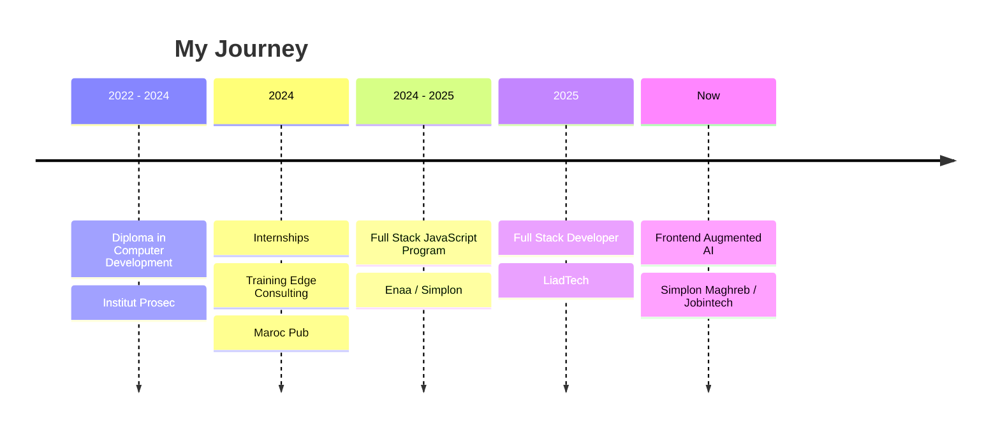

<!-- ═══════════════ HEADER BANNER ═══════════════ -->
<div align="center">


<a href="https://git.io/typing-svg">
  
</a>

<br/>

<a href="https://medfoliodev.netlify.app/"></a>
<a href="https://www.linkedin.com/in/mohammedbaba1505/"></a>
<a href="mailto:mohammedbaba1505@gmail.com"></a>

<br/><br/>


</div>

---

## 🎯 About Me

<table>
<tr>
<td width="55%" valign="top">

I'm a **passionate Full Stack Developer** specializing in the **MERN stack**. I craft modern, responsive web applications from front to back, with a strong focus on clean code, secure APIs, and smooth user experience.

I love technical challenges, and I learn best by **building real things**: from solo projects to team collaborations.

✨ **UI/UX lover** &nbsp;•&nbsp; 🔐 **Security-focused** &nbsp;•&nbsp; ⚙️ **API builder**
🚀 **Performance optimizer** &nbsp;•&nbsp; 🐳 **Docker enthusiast**

</td>
<td width="45%" valign="top">

```js
const mohammed = {
  role: "Full Stack Developer",
  stack: ["React", "Node.js", "MongoDB"],
  location: "Casablanca, Morocco 🇲🇦",
  languages: ["Arabic", "French", "English"],
  currentlyBuilding: [
    "💬 Real-time Chat App",
    "🎉 EventSphere"
  ],
  currentlyLearning: [
    "Redux", "Socket.io",
    "React Native", "Docker"
  ],
  lookingFor: "Collaboration & Team Projects",
  askMeAbout: ["React", "Framer Motion",
               "TypeScript", "Tailwind"]
};
```

</td>
</tr>
</table>

---

## 🔥 Currently

| | |
|---|---|
| 🔭 **Building** | A real-time **Chat App** (MERN + Socket.io) and **EventSphere**, an event ticketing platform |
| 🌱 **Learning** | **Redux**, **Socket.io**, **React Native**, advanced **Docker** workflows |
| 🤝 **Looking for** | **Collaborations** and **team projects**, because I'm leveling up beyond solo work |
| 💼 **Working on** | Both **individual** and **team** projects |

---

## 🚀 Featured Projects

<table>
<tr>
<td width="50%" valign="top">

### 🏨 Hotel Booking System
*Full-stack booking platform with online payment*


- 🔐 Secure REST API with **JWT + Bcrypt** authentication
- 💳 Online payments with **Stripe**
- 📧 Email notifications via **NodeMailer**
- 🧪 Tested with **Jest** • 🐳 **Docker** • ⚙️ **CI/CD**

</td>
<td width="50%" valign="top">

### 🏗️ Construction Project Manager
*Manage the full lifecycle of construction projects*


- 📋 Full **CRUD** for projects, tasks, resources & suppliers
- 🔎 Advanced **search & filtering**
- 🔗 MongoDB backend through a clean **REST API**
- 🔄 Complete project lifecycle management

</td>
</tr>
<tr>
<td width="50%" valign="top">

### 🎉 EventSphere *(In Progress)*
*Modern event ticketing platform with n8n automation*


- 🎟️ Browse events, **filter by category** (Music, Art, Shows, Football…)
- 🛒 **Redux Toolkit** cart with live total & navbar badge
- ✅ Checkout flow with animated confirmation + **automated email via n8n**
- 🔒 Protected **admin dashboard**: event CRUD + orders table

</td>
<td width="50%" valign="top">

### 💬 Real-Time Chat App *(In Progress)*
*Instant messaging with modern UX*


- ⚡ Real-time communication with **Socket.io**
- 🔐 User authentication
- 📱 Fully responsive UI

</td>
</tr>
</table>

<div align="center">
  <a href="https://github.com/med-more?tab=repositories"></a>
  <a href="https://github.com/med-more/react-portfolio-with-api.git"></a>
</div>

---

## 🛠️ Tech Stack

<div align="center">

**🎨 Frontend**


**⚙️ Backend & Databases**


**🚢 DevOps, Testing & Tools**


**🌱 Currently Learning**


</div>

---

## 💼 Experience



<details open>
<summary><b>🏢 LiadTech</b> — Full Stack Developer <i>(Sep 2025 – Nov 2025)</i></summary>
<br/>

- Built full-stack applications with the **MERN / PERN** stack (React, Node.js, MongoDB / PostgreSQL)
- Designed and optimized **REST APIs** following back-end best practices
- Delivered modern, reusable **React interfaces** (Hooks, UI/UX)

</details>

<details>
<summary><b>🏢 Maroc Pub</b> — Full Stack Developer <i>(Jun 2024 – Aug 2024)</i></summary>
<br/>

- Developed a **rental property management** system with PHP, HTML, Bootstrap
- Built a **blog platform** with PHP Laravel and Bootstrap

</details>

<details>
<summary><b>🏢 Training Edge Consulting</b> — Full Stack Developer <i>(May 2024 – Jun 2024)</i></summary>
<br/>

- Built an e-commerce platform for **semi-pharmaceutical products** using PHP, JavaScript, HTML, Bootstrap

</details>

---

## 🎓 Education & Training

| Period | Program | Institution |
|:---|:---|:---|
| **Oct 2025 – Present** | Frontend Augmented AI | Simplon Maghreb / Jobintech Casablanca |
| **Sep 2024 – Sep 2025** | Full Stack JavaScript Web Development | Enaa (École Numérique Ahmed Al Hansali) / Simplon |
| **Sep 2022 – Jul 2024** | Specialized Technician Diploma in Computer Development | Institut Prosec |

---

## 📊 GitHub Analytics

<div align="center">


<br/>


<br/>


</div>

### 🐍 Contribution Snake

<div align="center">


</div>

---

## 🤝 Let's Build Something Together

<div align="center">

I'm actively looking for **collaborations** and **team projects**, and I'm always up for:

🔥 Innovative MERN stack projects &nbsp;•&nbsp; 🚀 Open source contributions
👥 Team challenges &nbsp;•&nbsp; 💡 Startups & fresh ideas

<br/>

📫 **mohammedbaba1505@gmail.com** &nbsp;|&nbsp; 📞 **0652645566**

<br/>

<a href="https://medfoliodev.netlify.app/"></a>
<a href="https://www.linkedin.com/in/mohammedbaba1505/"></a>
<a href="https://github.com/med-more"></a>
<a href="mailto:mohammedbaba1505@gmail.com"></a>

<br/><br/>

<i>💡 "Building the future, one commit at a time."</i>

<br/>

<a href="https://visitcount.itsvg.in"></a>


</div>
